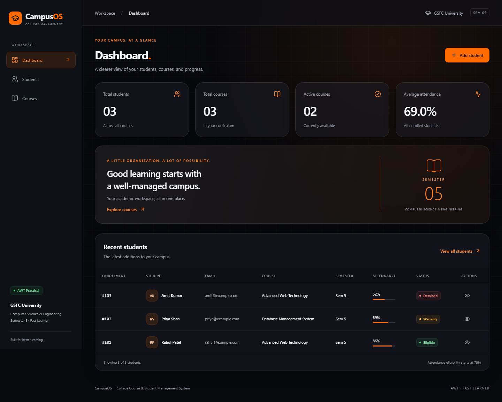
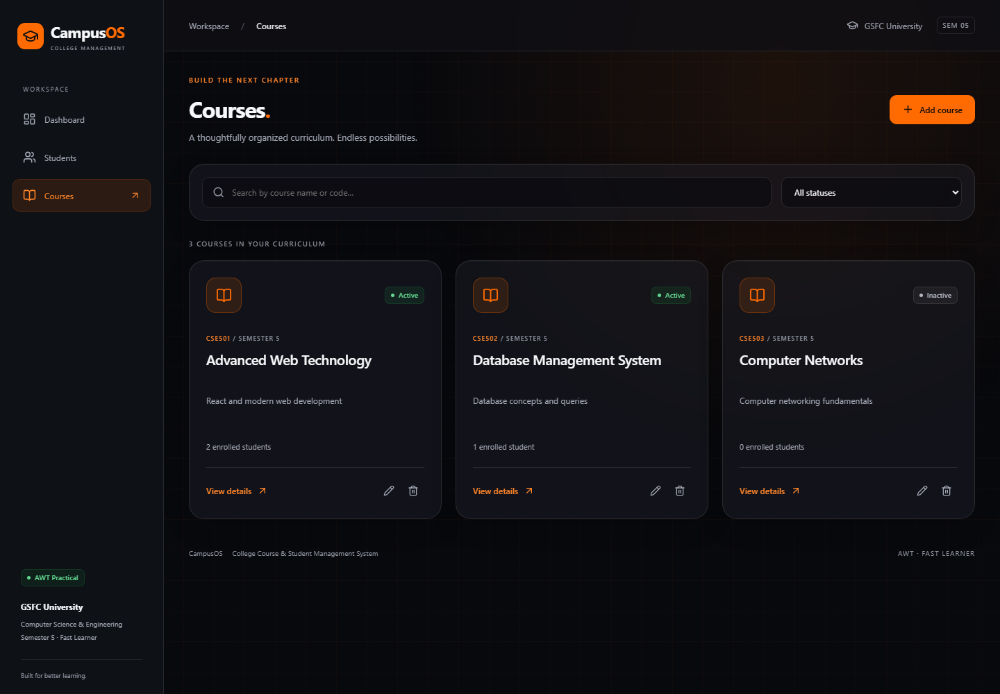
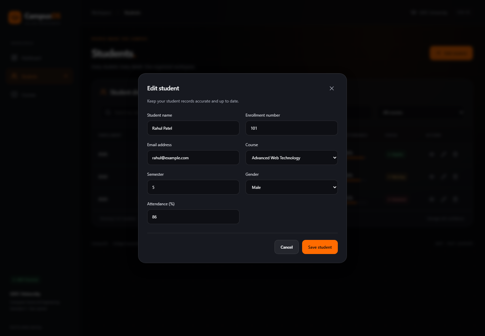
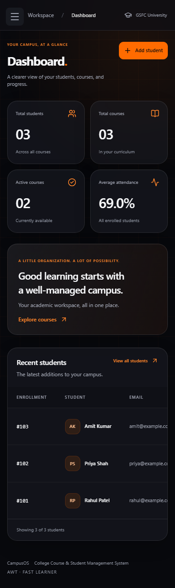
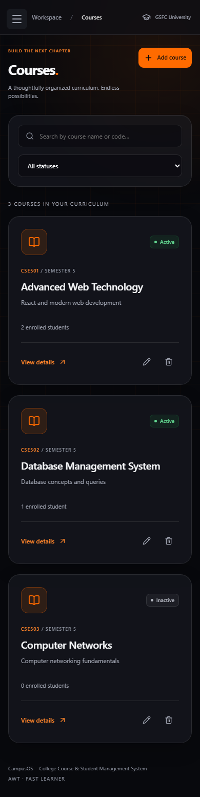
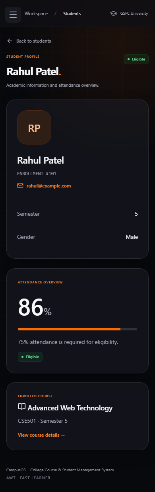
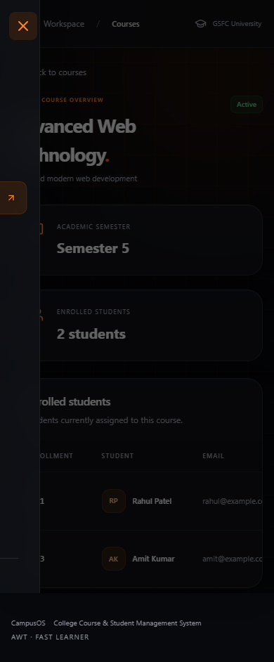

<div align="center">

# 🎓 CampusOS
### College Course & Student Management System

**A clearer view of your campus.**

React · Vite · JavaScript · Liquid Glass · localStorage

[Quick start](#-quick-start) · [Features](#-features) · [Screenshots](#-screenshots) · [Testing](#-testing)

</div>



A complete, responsive academic workspace built for the **Advanced Web Technology Fast Learner assignment at GSFC University**. Manage students and courses, track attendance eligibility, and keep records between browser sessions in a black-and-orange liquid-glass interface.

## ✨ Features

- **Live dashboard:** total students, total courses, active courses, average attendance, and the five most recently added students.
- **Student management:** add, edit, delete with confirmation, search by name/enrollment/email, combine search with course filtering, and view individual profiles.
- **Course management:** add, edit, search, filter by status, view enrollment, and delete unassigned courses. Assigned courses are protected against deletion.
- **Validated forms:** required fields, unique enrollment numbers and course codes (case-insensitive), email format, existing course selection, semesters 1–8, and attendance 0–100.
- **Attendance status:** consistent, labeled badges calculated through a shared utility.
- **Persistent records:** browser localStorage with visible failure warnings. Deleting all records keeps the directory empty after refresh.
- **Responsive interface:** desktop sidebar, mobile navigation drawer, scrollable tables, stacked forms, keyboard-operable dialogs, visible focus, reduced-motion support, and glass-effect fallback.
- **Real interactions:** no backend, login, paid APIs, or placeholder pages.

## 🛠 Technology stack

| Technology | Purpose |
|---|---|
| React.js 19 | Functional components, shared state, reusable UI |
| Vite 8 | Development server and production builds |
| JavaScript ES6+ & JSX | Application logic and declarative templates |
| React Router DOM 7 | Client-side navigation and dynamic detail routes |
| CSS3 | Custom design tokens, Grid/Flexbox, liquid glass, responsive layouts |
| Lucide React | Lightweight interface icons |
| React Hooks | useState, useEffect, useMemo, useRef, useId |
| Browser localStorage | Student and course persistence |
| Playwright (development only) | Functional browser checks and screenshot capture |
| Node.js test runner & Oxlint | Unit checks and source linting |

**No TypeScript, Tailwind, Bootstrap, Sass, UI framework, Redux, database, or backend.**

## 🚀 Quick start

Use **Node.js 22.12+** and npm (verified here with Node.js 26.3.1).

```bash
git clone https://github.com/tirthgandhi/AWT-FAST-LEARNER-.git
cd AWT-FAST-LEARNER-/college-management-system
npm install
npm run dev
```

Open the local URL printed by Vite, normally **http://localhost:5173**.

| Command | Purpose |
|---|---|
| `npm run dev` | Start development server |
| `npm run build` | Create production output in `dist/` |
| `npm run preview` | Preview the production build locally |
| `npm run lint` | Check application and test source |
| `npm run test:unit` | Test attendance boundaries and storage behavior |
| `npm test` | Run browser workflows and regenerate screenshots |

For production hosting, serve `dist/` and configure an **SPA fallback to index.html** so direct visits to detail routes work. No hosting service is required for the assignment.

## 📂 Folder structure

```text
AWT-FAST-LEARNER-/
├── README.md
├── screenshots/                  # Actual browser captures, embedded below
└── college-management-system/
    ├── public/favicon.svg
    ├── src/
    │   ├── components/
    │   │   ├── Navbar.jsx
    │   │   ├── DashboardCard.jsx
    │   │   ├── StudentCard.jsx
    │   │   ├── StudentForm.jsx
    │   │   ├── StudentTable.jsx
    │   │   ├── CourseCard.jsx
    │   │   ├── CourseForm.jsx
    │   │   ├── AttendanceBadge.jsx
    │   │   ├── GlassPanel.jsx
    │   │   ├── Modal.jsx
    │   │   └── ConfirmDialog.jsx
    │   ├── pages/
    │   │   ├── Dashboard.jsx
    │   │   ├── Students.jsx
    │   │   ├── StudentDetails.jsx
    │   │   ├── Courses.jsx
    │   │   └── CourseDetails.jsx
    │   ├── data/seedData.js
    │   ├── utils/
    │   │   ├── attendance.js
    │   │   └── storage.js
    │   ├── styles/
    │   │   ├── variables.css
    │   │   ├── global.css
    │   │   ├── glass.css
    │   │   └── responsive.css
    │   ├── App.jsx
    │   └── main.jsx
    ├── tests/
    │   ├── app.spec.js
    │   └── unit.test.js
    ├── .gitignore
    ├── .oxlintrc.json
    ├── index.html
    ├── package.json
    ├── package-lock.json
    ├── playwright.config.js
    ├── vite.config.js
    └── README.md
```

## 🧩 React concepts demonstrated

| Concept | Implementation |
|---|---|
| Functional components & JSX | All components and pages |
| Props | Shared records and callbacks passed from App to pages |
| useState | Records, controlled forms, filters, dialogs, feedback |
| useEffect | Persistence, dialog lifecycle, notification timer cleanup |
| useMemo | Dashboard statistics and filtered student/course lists |
| React.memo | Student rows and dashboard cards skip unchanged props |
| Event handling | Form submissions, searches, editing, deletion |
| Array operations | map, filter, find, some, reduce, slice |
| Conditional rendering | Empty states, dialogs, missing records, badges |
| Routing | Active navigation and parameterized detail pages |

Memoization is deliberately limited: filtering and statistics are derived only when their inputs change. Memoized rows can reuse unchanged records and stable state-setter callbacks. No global state library or complex caching layer is needed.

## 🧭 Routes

| Route | Screen |
|---|---|
| `/` | Redirects to dashboard |
| `/dashboard` | Academic overview |
| `/students` | Student directory and CRUD |
| `/students/:id` | Student profile |
| `/courses` | Course catalog and management |
| `/courses/:id` | Course information and enrolled students |
| Unknown path | Redirects to dashboard |
| Unknown student/course ID | Record Not Found with a return link |

## 🚦 Attendance rules

| Percentage | Status | Badge |
|---|---|---|
| 75–100 | Eligible | Green |
| 60–below 75 | Warning | Amber |
| 0–below 60 | Detained | Red |
| Invalid / out of range | Invalid | Red |

Exactly **60 is Warning** and exactly **75 is Eligible**. Every attendance badge uses `getAttendanceStatus()`. Dashboard average is the arithmetic mean of all student percentages; an empty directory displays 0%.

## 💾 Persistence contract

- `college_students` stores the student array; `college_courses` stores the course array.
- Sample data is used only when a key is absent or unreadable. A valid empty array stays empty.
- New records use `crypto.randomUUID()`; editing keeps the same ID.
- Browser storage failures show a persistent warning. The current session remains usable.
- Malformed JSON or non-array storage is preserved for recovery instead of overwritten; the affected collection uses demonstration data in memory and does not persist until the storage issue is repaired and the page reloaded.
- Data belongs to this browser and origin. It does not sync across devices. Clearing browser storage removes saved records. There is **no backend or authentication**.

## ✅ Testing

The project includes two Node unit tests and five Playwright browser workflows. Run:

```bash
npm run test:unit
npx playwright install chromium
npm test
npm run lint
npm run build
```

Browser tests start the development server automatically. They cover student create/edit/delete/cancel, duplicate enrollments, email and attendance validation, combined search/filtering, course create/edit/delete, assigned-course protection, detail pages, refresh persistence, empty arrays, invalid routes, malformed and denied storage, mobile navigation, and page overflow at mobile/tablet widths.

The screenshot workflow covers all five page types plus forms, the missing-record state, and responsive layouts. Screenshots use deterministic sample records and are saved in the repository's separate **screenshots/** folder. Tests also check for uncaught browser errors during student and screenshot workflows.

**Verification:** installation, development-server startup, production build, both unit tests, and all five Chromium browser tests were executed successfully during implementation. See [verification notes](TESTING.md) for the final recorded check results. Browser coverage is Chromium; other browser engines have not been tested.

## 📸 Screenshots

All images below are actual screenshots of the running application. Click an image to inspect it at full size.

### Desktop pages

| Student directory | Student details |
|---|---|
|  |  |

| Course catalog | Course details |
|---|---|
|  |  |

<details>
<summary><strong>Forms and missing-record screen</strong></summary>

| Add student | Edit student |
|---|---|
|  |  |

| Add course | Edit course |
|---|---|
|  |  |


</details>

<details>
<summary><strong>Mobile & tablet gallery</strong></summary>

| Dashboard | Students | Courses |
|---|---|---|
|  |  |  |

| Student details | Course details |
|---|---|
|  |  |

| Navigation drawer | Mobile form |
|---|---|
|  |  |


</details>

## 🎓 Academic details

| Field | Details |
|---|---|
| University | GSFC University |
| Department | Computer Science and Engineering |
| Semester | 5 |
| Subject | Advanced Web Technology |
| Assignment | Fast Learner |
| Project | College Course & Student Management System |

---

<div align="center">Designed for a focused, practical demonstration of modern React fundamentals.</div>
